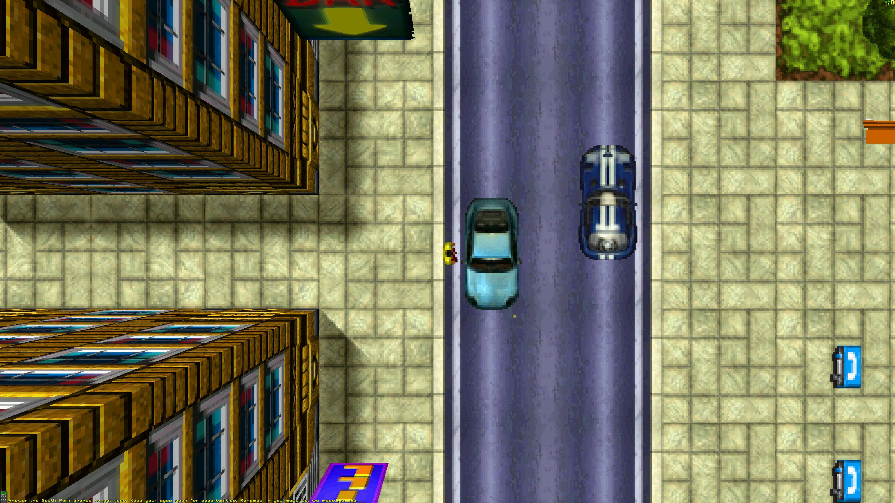
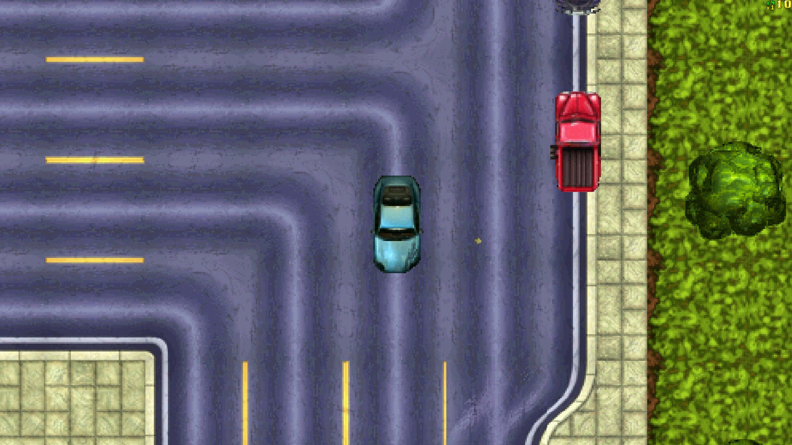
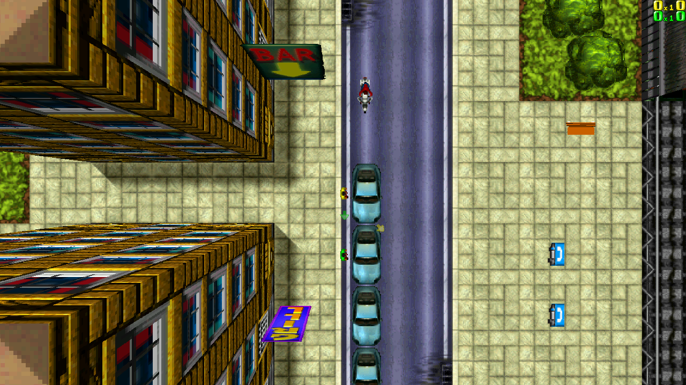
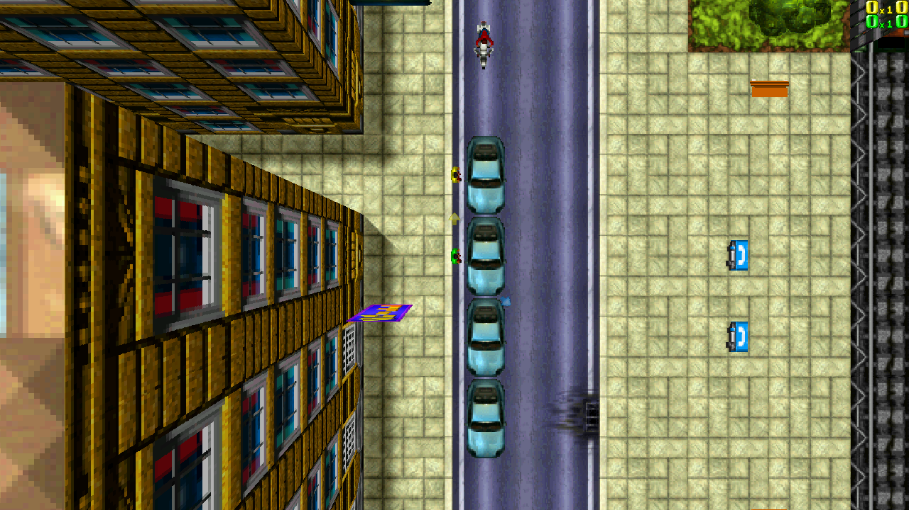
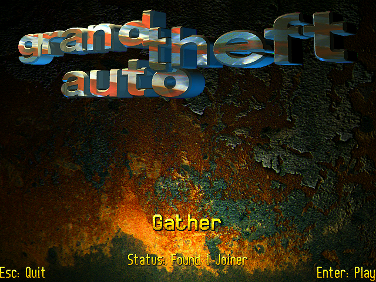
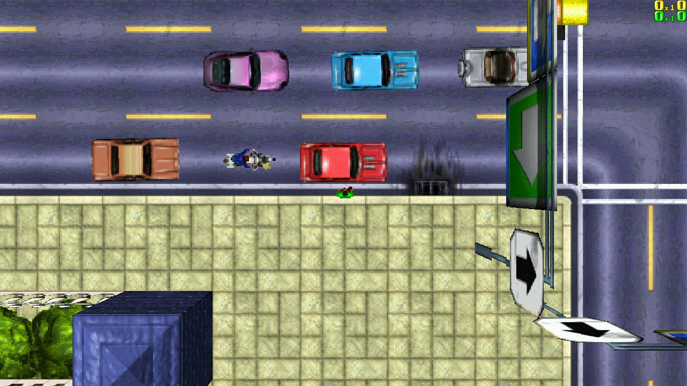
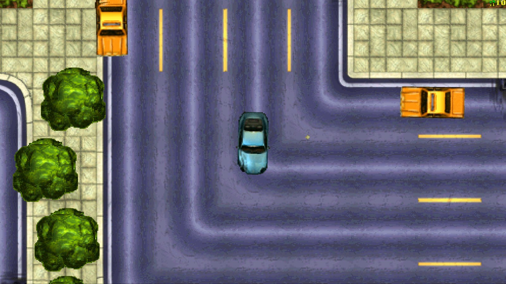
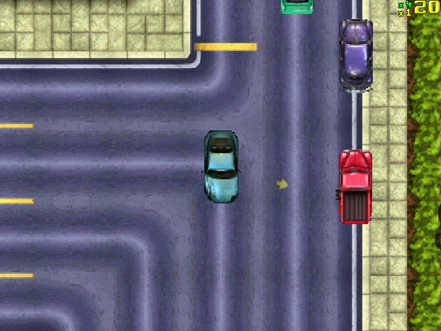

# Grand Theft Auto -- Static Recompilation

**[Download the installer](https://github.com/sp00nznet/gta/releases)** (Windows), or run `Setup.cmd`. You need the game: Rockstar's freeware release, or your own disc.

A static recompilation of the original **Grand Theft Auto** (1997) by DMA Design,
and its mission pack **GTA: London 1969**, targeting modern Windows. No
emulation: the original x86 machine code is lifted to compilable C, linked
against modern replacements for the legacy APIs, and compiled into a native
executable -- with the remaster the game never had, built around its own code.

Built on the [pcrecomp](https://github.com/sp00nznet/pcrecomp) toolchain, with
no commercial tools: pcrecomp's own disassembler finds the functions and its
lifter writes the C.



*Every pixel comes from the game's own code: the recompiled renderer drawing
into the port's DirectDraw, at 3840x2160. Captured from that surface, not from
the screen.*

## What the remaster adds

- **Its own window**: a Direct3D 11 presenter, resizable or borderless
  fullscreen (F11, Alt+Enter), sharp at any size and on high-DPI screens.
- **Scaling** (F12): sharp-bilinear by default, smooth, CRT, nearest, or whole
  multiples only.
- **A settings menu** (F10, or right-click): resolution, scaling, fullscreen,
  the controller, without editing an INI.
- **High resolution and widescreen**: 1280x720 up to 3840x2160 and
  ultrawide 3440x1440, Hor+, so wider screens show more of the city
  ([remaster.md](docs/remaster.md)).
- **Xbox controller** (XInput), mapped to the game's own keys by
  `controller.ini`.
- **Network play**, as shipped: GTA1's own four-player deathmatch through
  its own DirectPlay, between copies on one machine or over a LAN
  ([multiplayer.md](docs/multiplayer.md)).
- **Co-op** (`--coop`, a mod): the network game on the single-player
  campaign -- the same city and missions, players side by side
  ([coop.md](docs/coop.md)).
- **One-click setup**: `Setup.cmd` or the installer extract, lift, patch and
  build from your copy.

`--classic` gives the original 640x480 window.

## Getting Started

You need **your own copy** of the game. This repository never includes game
files, and nothing from the game is downloaded for you.

**Grand Theft Auto** is freeware: Rockstar gave it away as the first of its
*Rockstar Classics* free downloads. Rockstar no longer hosts it; its own page
survives on the Internet Archive:
[Rockstar Classics -- Grand Theft Auto](https://web.archive.org/web/20041223112508/http://www.rockstargames.com:80/classics/gta.html).
Use that (its `GTAINSTALLER.zip`), or your own retail disc.

**GTA: London 1969** was never part of the freeware release (only the later
London 1961 add-on was, and it needs GTA1 and London 1969 to run). For London,
bring your own copy.

### The installer (easiest)

1. Download `GTA-Recomp-Installer-windows-x64.exe` from the
   [latest release](https://github.com/sp00nznet/gta/releases). It isn't
   signed: if SmartScreen asks, **More info**, then **Run anyway**.
2. Point it at `GTAINSTALLER.zip`, a folder holding its `data1.cab`, or an
   extracted copy, and press **Build**.
3. **Play**.

### The setup script

1. Download this repository (**Code**, then **Download ZIP**) and unzip it
   somewhere with 3 GB free.
2. Double-click **`Setup.cmd`** and give it `GTAINSTALLER.zip` when it asks.
3. Play with `Grand Theft Auto (recomp)` in that folder.

It asks before installing anything (Python, the Visual Studio Build Tools),
then extracts, lifts, patches and builds; about 20 minutes the first time,
and a rerun skips finished steps. By hand, it is these four steps:

### 1. Extract the game

The freeware build is an InstallShield installer. Extract its cabinets:

```bash
python ../pcrecomp-gta/tools/assets/isextract.py game/data1.cab game/data1.cab -o game/extracted_full
```

The archive spans `data1.cab` and `data2.cab`; all 195 files should extract.

### 2. Lift it

```bash
python tools/lift.py "game/extracted_full/WINO/Grand Theft Auto.exe"
python tools/patch_gen.py
```

About 12 minutes. That catalogs the executable with pcrecomp's `disasm32`
(kept in `work/`) and writes the C into `src/recomp/gen/`; `patch_gen.py`
applies the remaster's hooks to it. The lifted C is machine-translated from the
game, so it is generated on your machine and never checked in.
`tools/lift.py` finds pcrecomp at `../pcrecomp-gta` or `../pcrecomp`, or
wherever `PCRECOMP` points.

### 3. Build

```bash
cmake -B build -G "Visual Studio 17 2022" -A Win32
cmake --build build --config Release
```

Requires CMake 3.20+, Visual Studio 2022 (Win32), and Python 3.10+ with
`capstone` and `pefile`.

### 4. Play

```bash
cd game/extracted_full/WINO
../../../build/bin/Release/gta1.exe "Grand Theft Auto.exe"
```

Run from the directory holding the executable: the game finds its data as
`..\gtadata\`. The original executable is the argument; it is mapped at
`0x400000` so the lifted code can read its `.rdata` and `.data`. It is never
run.

| | |
|---|---|
| `--res 2560x1440` | the in-game resolution (the front end is always 640x480) |
| `--view 75` | zoom out: percent of the original camera scale |
| `--scale crt`, `--fullscreen` | the presenter's starting state |
| `--join 192.168.1.20` | where a network game's host is |
| `--coop` | network games are co-op on the campaign |
| `--classic` | the original window |

Controls are the game's defaults: arrows to move, Enter to get in or out of a
car, Ctrl to attack, Space to brake, Z/X to change weapon, Tab special, Esc to
quit. In the game: F10 settings, F11 fullscreen, F12 scaling.

## Status

**Playable, remastered, networked.** In GTA1: the front end, Liberty City,
walking, stealing and driving through traffic, the radio, the quit prompt and
a clean exit; 640x480 to 3840x2160; a two-player network game on one machine
and over the LAN; co-op on the campaign. London 1969 reaches its own menu and
plays, in the presenter at 640x480.

| | Grand Theft Auto | GTA: London 1969 |
|---|---|---|
| Functions found | 6,625 entries, 2,203 bodies (95.7% of `.text`) | 9,954 entries, 5,150 bodies (75.8% of `.text`) |
| Lifted to C | 0 errors | 0 errors |
| Remaster | presenter, 720p-4K Hor+, pad, F10, setup | presenter, pad (640x480) |
| Network | deathmatch, two copies, loopback and LAN; co-op | not tried |

Not yet: saved games, four players at once, co-op's shared score and friendly
fire ([coop.md](docs/coop.md)), London's widescreen. Details in
[docs/PROGRESS.md](docs/PROGRESS.md).

## Screenshots

From the game's own DirectDraw surface, headless and muted.

**1920x1080**, Hor+: the camera's scale follows the height, so 16:9 shows
the 4:3 picture and more of the city to the sides.



**Co-op**: the host's screen (left) and the partner's (right), the two players
at the campaign's start in Liberty City, each copy drawing the same street.

| | |
|---|---|
|  |  |
|  |  |
|  |  |
|  |  |
|  |  |

## The Interesting Bugs

A recompilation fails a long way from its cause, so these are worth recording.

**4K wrote over the list of video modes.** At 3840x2160 the game crashed after
the mode change, reading a null out of its own mode table. Nothing had freed
it: the frame's row table -- one address per scanline, in `.data` at 0x503228 --
has room for 1706 rows, and the 2160th row lands on the mode table's pointer.
Its 110 uses in the lifted C now point at a bigger table.

**F12 opened the game's own video menu.** The presenter took F12 for its
scaling in the window procedure, and the game took it too: it reads keys in
its own message loop as well. The presenter's keys now leave the queue in
`PeekMessageA`.

**The second copy quit.** For a network game on one machine, the second copy
found the first one's single-instance mutex and left without a word.

**The front end was never stuck.** For a month the open problem was "the front
end never starts the loaded game": after Liberty City loaded, the game span on
a function returning -1. That function is *which network player am I*, and -1
is the right answer for a single-player game -- the game had long since left the
front end, switched to its in-game display mode and was trying to draw. Three
things stopped it, none of them in the menu:

- `IDirectDrawSurface::EnumAttachedSurfaces` returned success without calling
  the game's callback, so the in-game renderer never found its back buffers.
  It asks for a primary and seven, and walks the chain one by one.
- Miles timers never fired, so the frame limiter, which spins on a tick counter
  without calling anything, waited forever.
- Every key binding read back as zero from the port's own registry, so on the
  street no key did anything. The defaults now come from GTA Settings' own
  "Default Keys" table.

**The quit crash was the original code running.** MGL subclasses the game
window with `SetWindowLongA(GWL_WNDPROC, 0x48C8D0)`, and the bridge handed that
address straight to Windows -- which then ran the 1997 machine code for every
window message, and died on the first one that called an import: `GetKeyState`,
when Esc was pressed.

**Every zero looked negative.** The game asked for `..\GTADATA\AUDIO\LEVEL-00.RAW`
when the file on disk is `LEVEL000.RAW`. The lifted `_output` decided sign with
`test edx,edx / jg / jl`, and the second jump sat in a different basic block from
the compare, where the lifter had discarded what set the flags. One branch, and
every zero the CRT ever formatted came out negative.

**The radio was switched off by one probe and one bad file.** At startup GTA1
opens each of its ten radio tracks and asks Miles for its length; a length
under 1 means "no such track", and one missing track switches the radio off for
the whole game. The shim answered 0 for every length. Track8.wav was also broken:
it spans the two install cabinets, and the extractor read all of it from the
first. Then the mixer's 32-bit 16.16 position wrapped every three seconds.

**It played at 320x200 because the shim offered 320x200.** The in-game mode is
entry 0 of a table the game builds from `EnumDisplayModes`, unless the player
picks another in Options. Real drivers do not list 320-wide modes; the shim did.

**Four bytes, one million times.** `AIL_ms_count` is `@0`, not `@4`; the bridge
popped one argument too many. The game busy-waits on it, so the stack pointer
climbed four bytes per call until it walked off the top of the simulated stack.

The full log is in [docs/BRINGUP.md](docs/BRINGUP.md), including the theories
that were confidently wrong.

## Supported Games

| Game | Year | Executable | Compiler | Status |
|------|------|-----------|----------|--------|
| Grand Theft Auto | 1997 | `Grand Theft Auto.exe` (freeware) | MSVC 6.0 | **Playable** |
| Grand Theft Auto | 1997 | `gtawin.exe` (original) | MSVC 4.2 | Analyzed |
| GTA London 1969 | 1999 | `gta_uk.exe` | MSVC 5.1 | **Playable** |
| GTA London 1961 | 1999 | `GTA_61.exe` | MSVC 5.1 | Analyzed |
| Grand Theft Auto 2 | 1999 | `gta2.exe` | MSVC 5.1 | Unwrapped and lifted (its own repo, in progress) |

All of these share the **Race'n'Chase** engine, written by Mike Dailly at DMA
Design. GTA1 and London run the identical engine -- London is a mission pack.

London lifts and builds the same way:

```bash
python tools/lift.py "<London>/gtawin/gta_uk.exe" src/recomp/gen_london69
cmake -B build && cmake --build build --config Release --target london
cd "<London>/gtawin" && <repo>/build/Release/london.exe gta_uk.exe
```

## Architecture

```
src/
  engine/       Runtime, IAT bridges, image loader, premap launcher
  video/        DirectDraw shim, Smacker shim
  sound/        waveOut mixer replacing the Miles Sound System
  remaster/     The presenter, high resolution, the pad, settings
  net/          DirectPlay over TCP; co-op
  recomp/gen/           Lifted GTA1   (generated, never committed)
  recomp/gen_london69/  Lifted London (generated, never committed)
tools/
  lift.py          Catalog (pcrecomp disasm32) and lift (pcrecomp drive32)
  patch_gen.py     Post-lift patches: hooks, line patches, a moved table
  run.py           Run a build on a private hidden desktop, muted
  net_pair.sh      A network game between two hidden copies
  setup.ps1        Setup.cmd: extract, lift, patch, build
docs/
  TECHNICAL.md   Engine, binary, formats, import surface
  BRINGUP.md     How it gets 0x400000, diagnostics, the fix log
  PROGRESS.md    Phase-by-phase detail and known gaps
  remaster.md    The presenter, widescreen, the pad, setup
  multiplayer.md The network game and the DirectPlay behind it
  coop.md        Co-op: the design and what the game allows
```

The lifted code's CPU contract is pcrecomp's `runtime/recomp32/recomp_types.h`;
the runtime, bridges and shims here are this project's own. The presenter and
the controller mapper come from the Gunman Chronicles recomp, the setup script
from Gunman's and Red Alert 2's.

## Documentation

- [docs/TECHNICAL.md](docs/TECHNICAL.md): the Race'n'Chase engine, GTA1's PE
  layout, subsystems, data formats, import surface, MGL notes
- [docs/BRINGUP.md](docs/BRINGUP.md): how the image gets its original base, the
  diagnostic switches, scripted input, and the full fix log
- [docs/PROGRESS.md](docs/PROGRESS.md): phase checklists and known gaps
- [docs/remaster.md](docs/remaster.md): the presenter, high resolution and
  widescreen (five fixes in the game's own code), the controller, setup
- [docs/multiplayer.md](docs/multiplayer.md): network play, the ten DirectPlay
  methods the game uses, testing two copies
- [docs/coop.md](docs/coop.md): co-op -- how levels and missions are built, the
  design, what is done and what is not

## License

The code in this repository is released under the [MIT License](LICENSE). That
covers this project's own source: the runtime, the IAT bridges, the DirectDraw,
Miles, Smacker and DirectPlay shims, the remaster, the launcher and the tooling.

It does **not** cover Grand Theft Auto. The game's binary, assets and data
remain the property of their owners and are not distributed here. Neither is the
lifted C: it is machine-translated from the original executable and carries
whatever rights the executable does, so it is generated on your machine, from
your copy, and never checked in.

## Legal

This project is for game preservation. You must supply your own copy of the
game. No copyrighted game assets are included in this repository.

Rockstar Games made Grand Theft Auto and Grand Theft Auto 2 freely available
for years, which is the only reason this project targets them rather than a
title still being sold. If the rights holders would prefer this not exist, say
so and it comes down.

## Credits

The game itself is the work of **DMA Design** -- **Mike Dailly** wrote the
Race'n'Chase engine this recompilation is built on, and it is a genuinely good
piece of 1990s engineering to read. Published by BMG Interactive, now
**Rockstar Games**, who released it as freeware.

Standing on:

- [pcrecomp](https://github.com/sp00nznet/pcrecomp) -- the unified PC static
  recompilation toolkit this project shares with its siblings
- [Capstone](https://www.capstone-engine.org/) -- disassembly
- **SciTech Software** for MGL and **RAD Game Tools** for Smacker and the Miles
  Sound System -- the libraries being stood in for here

## Related Projects

Part of the [sp00nznet](https://github.com/sp00nznet) recompilation collection:

- [xwa](https://github.com/sp00nznet/xwa) -- X-Wing Alliance, D3D11 backend and
  3D flight
- [burnout3](https://github.com/sp00nznet/burnout3) -- original Xbox x86 recomp
- [bw](https://github.com/sp00nznet/bw) -- Black & White, Win32 game patterns
- [civ](https://github.com/sp00nznet/civ) -- Civilization, 16-bit x86 lifting
