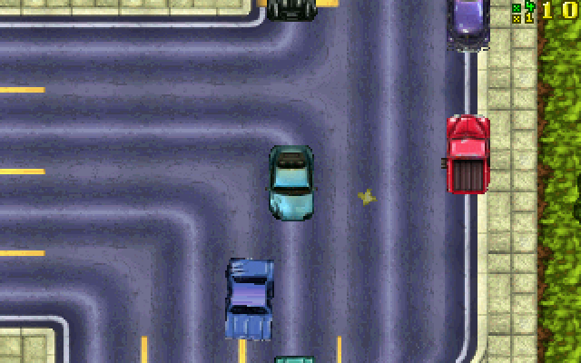
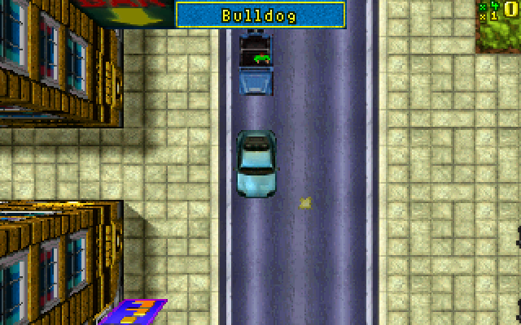
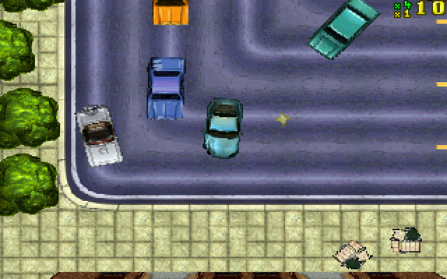
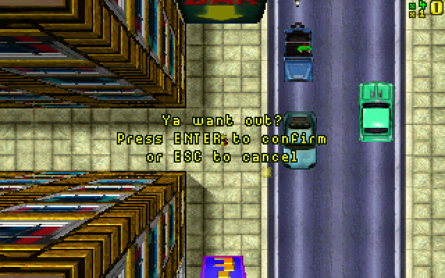
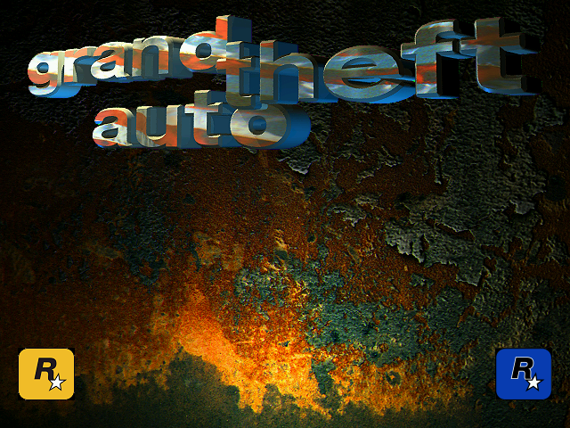
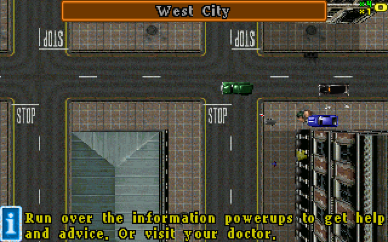
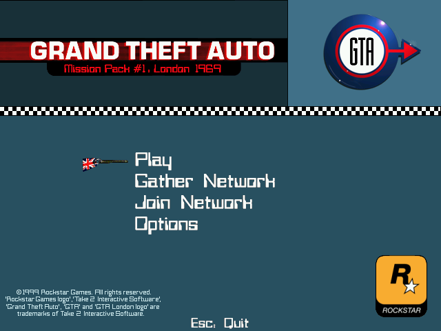

# Grand Theft Auto -- Static Recompilation

A static recompilation of the original **Grand Theft Auto** (1997) by DMA Design,
targeting modern Windows. No emulation: the original x86 machine code is lifted
to compilable C, linked against modern replacements for the legacy APIs, and
compiled into a native executable.

Built on the [pcrecomp](https://github.com/sp00nznet/pcrecomp) toolchain, with
no commercial tools: pcrecomp's own disassembler finds the functions and its
lifter writes the C.

It plays. You walk the streets of Liberty City, take a car and drive it.



*Every pixel comes from the game's own code: the recompiled renderer drawing
into a DirectDraw flipping chain the port builds out of its own COM vtables.
Captured from that surface, not from the screen.*

## Getting Started

You need **your own copy** of the game. This repository never includes game
files, and nothing from the game is downloaded for you.

**Grand Theft Auto** is freeware: Rockstar gave it away as the first of its
*Rockstar Classics* free downloads. Rockstar no longer hosts it; its own page
survives on the Internet Archive:
[Rockstar Classics -- Grand Theft Auto](https://web.archive.org/web/20041223112508/http://www.rockstargames.com:80/classics/gta.html).
Use that, or your own retail disc.

**GTA: London 1969** was never part of the freeware release (only the later
London 1961 add-on was, and it needs GTA1 and London 1969 to run). For London,
bring your own copy.

Keep game files in `original/` or `game/`: both are gitignored.

### 1. Extract the game

The freeware build is an InstallShield installer. Extract its cabinets:

```bash
python ../tools/tools/assets/isextract.py game/data1.cab game/data1.cab -o game/extracted_full
```

The archive spans `data1.cab` and `data2.cab`; all 195 files should extract.

### 2. Lift it

```bash
python tools/lift.py "game/extracted_full/WINO/Grand Theft Auto.exe"
python tools/soften_fatal.py
```

About 12 minutes. That catalogs the executable with pcrecomp's `disasm32`
(kept in `work/`) and writes the C into `src/recomp/gen/`. The lifted C is
machine-translated from the game, so it is generated on your machine and never
checked in. `tools/lift.py` finds pcrecomp at `../pcrecomp-gta` or
`../pcrecomp`, or wherever `PCRECOMP` points.

### 3. Build

```bash
cmake -B build -G "Visual Studio 17 2022" -A Win32
cmake --build build --config Release
```

Requires CMake 3.20+, Visual Studio 2022 (Win32), and Python 3.10+ with
`capstone` and `pefile`.

### 4. Play

```bash
cd game/extracted_full/WINO
../../../build/bin/Release/gta1.exe "Grand Theft Auto.exe"
```

Run from the directory holding the executable: the game finds its data as
`..\gtadata\`. The original executable is the argument; it is mapped at
`0x400000` so the lifted code can read its `.rdata` and `.data`. It is never
run.

Controls are the game's defaults: arrows to move, Enter to get in or out of a
car, Ctrl to attack, Space to brake, Z/X to change weapon, Tab special, Esc to
quit.

## Status

**Playable in Liberty City and in London.** In GTA1: the front end, a city loaded through its own
menu, walking, stealing a car and driving it through traffic, the quit prompt,
the results screen, and a clean exit. London 1969 reaches its own menu and
plays: it starts you in a car in West City.

| | Grand Theft Auto | GTA: London 1969 |
|---|---|---|
| Functions found | 6,625 entries, 2,203 bodies (95.7% of `.text`) | 9,954 entries, 5,150 bodies (75.8% of `.text`) |
| Lifted to C | 0 errors | 0 errors |
| How far it runs | **in game**: walk, drive, quit | **in game**: its menu, then driving through West City |

Against the August lift (2,590 functions from a hand-run discovery pipeline,
an hour to lift), the relift on today's pcrecomp finds 4,211 more entry points
and drops 176 that were never real -- every one of them a start in the middle
of another instruction. It takes 12 minutes.

Not yet: music (the game streams it, the mixer has not been told to start it),
the game's resolution choice (it plays at 320x200), saved games, and
multiplayer. Details in [docs/PROGRESS.md](docs/PROGRESS.md).

## Screenshots

From the game's own DirectDraw surface, headless and muted.

| | |
|---|---|
|  |  |
|  |  |
|  |  |

## The Interesting Bugs

A recompilation fails a long way from its cause, so these are worth recording.

**The front end was never stuck.** For a month the open problem was "the front
end never starts the loaded game": after Liberty City loaded, the game span on
a function returning -1. That function is *which network player am I*, and -1
is the right answer for a single-player game -- the game had long since left the
front end, switched to its in-game display mode and was trying to draw. Three
things stopped it, none of them in the menu:

- `IDirectDrawSurface::EnumAttachedSurfaces` returned success without calling
  the game's callback, so the in-game renderer never found its back buffers.
  It asks for a primary and seven, and walks the chain one by one.
- Miles timers never fired, so the frame limiter, which spins on a tick counter
  without calling anything, waited forever.
- Every key binding read back as zero from the port's own registry, so on the
  street no key did anything. The defaults now come from GTA Settings' own
  "Default Keys" table.

**The quit crash was the original code running.** MGL subclasses the game
window with `SetWindowLongA(GWL_WNDPROC, 0x48C8D0)`, and the bridge handed that
address straight to Windows -- which then ran the 1997 machine code for every
window message, and died on the first one that called an import: `GetKeyState`,
when Esc was pressed.

**Every zero looked negative.** The game asked for `..\GTADATA\AUDIO\LEVEL-00.RAW`
when the file on disk is `LEVEL000.RAW`. The lifted `_output` decided sign with
`test edx,edx / jg / jl`, and the second jump sat in a different basic block from
the compare, where the lifter had discarded what set the flags. One branch, and
every zero the CRT ever formatted came out negative.

**Four bytes, one million times.** `AIL_ms_count` is `@0`, not `@4`; the bridge
popped one argument too many. The game busy-waits on it, so the stack pointer
climbed four bytes per call until it walked off the top of the simulated stack.

The full log is in [docs/BRINGUP.md](docs/BRINGUP.md), including the theories
that were confidently wrong.

## Supported Games

| Game | Year | Executable | Compiler | Status |
|------|------|-----------|----------|--------|
| Grand Theft Auto | 1997 | `Grand Theft Auto.exe` (freeware) | MSVC 6.0 | **Playable** |
| Grand Theft Auto | 1997 | `gtawin.exe` (original) | MSVC 4.2 | Analyzed |
| GTA London 1969 | 1999 | `gta_uk.exe` | MSVC 5.1 | **Playable** |
| GTA London 1961 | 1999 | `GTA_61.exe` | MSVC 5.1 | Analyzed |
| Grand Theft Auto 2 | 1999 | `gta2.exe` | MSVC 5.1 | Blocked (TAC-packed) |

All of these share the **Race'n'Chase** engine, written by Mike Dailly at DMA
Design. GTA1 and London run the identical engine -- London is a mission pack.

London lifts and builds the same way:

```bash
python tools/lift.py "<London>/gtawin/gta_uk.exe" src/recomp/gen_london69
cmake -B build && cmake --build build --config Release --target london
cd "<London>/gtawin" && <repo>/build/Release/london.exe gta_uk.exe
```

## Architecture

```
src/
  engine/       Runtime, IAT bridges, image loader, premap launcher
  video/        DirectDraw shim, Smacker shim
  sound/        waveOut mixer replacing the Miles Sound System
  renderer/     Modern OpenGL 4.x, replacing SciTech MGL (not yet wired)
  net/          Network play replacing DirectPlay (stub)
  recomp/gen/           Lifted GTA1   (generated, never committed)
  recomp/gen_london69/  Lifted London (generated, never committed)
tools/
  lift.py          Catalog (pcrecomp disasm32) and lift (pcrecomp drive32)
  soften_fatal.py  Post-lift patch so one failed check does not hide the rest
  run.py           Run a build on a private hidden desktop, muted
docs/
  TECHNICAL.md   Engine, binary, formats, import surface
  BRINGUP.md     How it gets 0x400000, diagnostics, the fix log
  PROGRESS.md    Phase-by-phase detail and known gaps
```

The lifted code's CPU contract is pcrecomp's `runtime/recomp32/recomp_types.h`;
the runtime, bridges and shims here are this project's own.

## Documentation

- [docs/TECHNICAL.md](docs/TECHNICAL.md): the Race'n'Chase engine, GTA1's PE
  layout, subsystems, data formats, import surface, MGL notes
- [docs/BRINGUP.md](docs/BRINGUP.md): how the image gets its original base, the
  diagnostic switches, scripted input, and the full fix log
- [docs/PROGRESS.md](docs/PROGRESS.md): phase checklists and known gaps

## License

The code in this repository is released under the [MIT License](LICENSE). That
covers this project's own source: the runtime, the IAT bridges, the DirectDraw,
Miles and Smacker shims, the launcher and the tooling.

It does **not** cover Grand Theft Auto. The game's binary, assets and data
remain the property of their owners and are not distributed here. Neither is the
lifted C: it is machine-translated from the original executable and carries
whatever rights the executable does, so it is generated on your machine, from
your copy, and never checked in.

## Legal

This project is for game preservation. You must supply your own copy of the
game. No copyrighted game assets are included in this repository.

Rockstar Games made Grand Theft Auto and Grand Theft Auto 2 freely available
for years, which is the only reason this project targets them rather than a
title still being sold. If the rights holders would prefer this not exist, say
so and it comes down.

## Credits

The game itself is the work of **DMA Design** -- **Mike Dailly** wrote the
Race'n'Chase engine this recompilation is built on, and it is a genuinely good
piece of 1990s engineering to read. Published by BMG Interactive, now
**Rockstar Games**, who released it as freeware.

Standing on:

- [pcrecomp](https://github.com/sp00nznet/pcrecomp) -- the unified PC static
  recompilation toolkit this project shares with its siblings
- [Capstone](https://www.capstone-engine.org/) -- disassembly
- **SciTech Software** for MGL and **RAD Game Tools** for Smacker and the Miles
  Sound System -- the libraries being stood in for here

## Related Projects

Part of the [sp00nznet](https://github.com/sp00nznet) recompilation collection:

- [xwa](https://github.com/sp00nznet/xwa) -- X-Wing Alliance, D3D11 backend and
  3D flight
- [burnout3](https://github.com/sp00nznet/burnout3) -- original Xbox x86 recomp
- [bw](https://github.com/sp00nznet/bw) -- Black & White, Win32 game patterns
- [civ](https://github.com/sp00nznet/civ) -- Civilization, 16-bit x86 lifting
