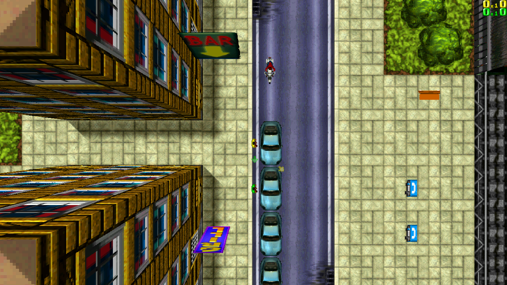

# Co-op (`--coop`)

GTA1's network game is deathmatch only. `--coop` makes it a network game on the
single-player campaign instead: the same city, the same phones and pager
missions, two to four players in it together. It is an opt-in mod; without the
flag nothing changes.

```
gta1.exe "Grand Theft Auto.exe" --coop                       # host: Gather Network
gta1.exe "Grand Theft Auto.exe" --coop --join 192.168.1.20   # partner: Join Network
```

Every player passes `--coop` (or `[net] coop=1` in `gta1.ini`).



## What the game's own code allows

**Levels are script sections.** `GTADATA\MISSION.INI` holds every level as a
numbered section: the campaign is 1 and 2 (Liberty City), 102 and 103 (San
Andreas), 202 and 203 (Vice City); the network levels are 1001-1004, 1101-1104
and 1201-1204, one set per city. Each section is a header (name, map, style),
a list of objects and a script, and both kinds run on the same interpreter:

```
[1]                                         [1001]
Easy Liberty City NEW, 22, nyc.cmp, 0,      DEATHMATCH1, 22, nyc.cmp, 0,
293 1 (106,119,4) PARKED 31 0               0 1 (136,77,4) PARKED 0 0
294 1 (105,119,4) PLAYER 293 256            4 1 (135,77,4) PLAYER 0 256
0 1 (108,108,4) TELEPHONE 0 768             5 1 (157,85,4) PLAYER 1 512
...                                         ... POWERUP, TRIGGER, a script
5260 IS_PED_ARRESTED 294 0 5260 0 0         ...
```

- A `PLAYER` object is a spawn point, and its first number is the car it starts
  beside. The *n*th `PLAYER` in a section is player *n*: the network levels
  have four, the campaign one.
- Campaign scripts name the player by that object's id (`IS_PED_ARRESTED 294`).
  They were written for one player, though the interpreter has two-player
  commands (`PLAYER_ARE_BOTH_ONSCREEN`, `WAIT_FOR_PLAYERS`), and the first
  Liberty City section already uses `PLAYER_ARE_BOTH_ONSCREEN` once.
- **The network game is lock-step.** Every copy runs the whole simulation and
  the script; the frames carry the players' inputs. So anything that is the
  same on every copy -- the level, the objects, the script -- stays in step
  with no network code of ours.
- **The host chooses the level.** The front end sets the mission number with
  `sub_0044AB50` from its city table, and the startup handshake
  (`sub_0044BD70`) sends it to the joiners, who set it with the same function.

## The design

| | How | Status |
|---|---|---|
| Shared level and missions | `sub_0044AB50` turns a network level (1001-1299) into its city's first campaign level (1, 102, 202) on every copy | **built** |
| Everyone in it | The game opens a rewritten copy of `MISSION.INI` (in the temp folder; the original is never touched) where each campaign level has three more `PLAYER` spawn points, each with a parked car of the player's model, beside the first | **built** |
| Missions | The campaign script drives player 1 (the host): the phones, the pager, the arrow, the level's target. The partner rides along, drives, fights | **built** (the game's own behaviour) |
| Respawn near the partner | The network game respawns a dead player at its spawn point, which is now beside the others' | partly: near the *start*, not the partner |
| Shared score | One score, both players' points | designed, not built |
| Friendly fire off | Players' attacks do no damage to each other | designed, not built |

The two not built need the game's damage and score code mapped: the score is
per player (the HUD shows both, `0:0`), and a shared one means routing the
partner's points into player 1's, the same way on every copy so the lock-step
holds. Friendly fire is a test in the hit code on whether attacker and victim
are both players. Both are hooks of the kind `tools/patch_gen.py` already
applies; neither is needed for the mode to play.

## What was checked

`tools/net_pair.sh` with `HARGS=--coop CARGS=--coop`: the host's
`Gather Network` on Liberty City becomes mission 1, both copies open the
rewritten `MISSION.INI` (`four players in 6 campaign levels`), both load the
campaign's start, and both players stand beside the row of cars, each copy
showing the same street, with the mission arrow pointing player 1 to the phone.

Not yet checked: a pager mission played through to its end with a partner,
and three or four players.

## Split screen

Out of scope. The engine has one view per copy (`0x74F160` is a per-player
view array, but the frame is drawn for the local player only).
